<picture>
  <source media="(prefers-color-scheme: dark)" srcset="./assets/profile-dark.svg" />
  <source media="(prefers-color-scheme: light)" srcset="./assets/profile-light.svg" />
  
</picture>

  <a href="https://akash-s-portfolio-lco5.vercel.app/">Portfolio</a>
  &nbsp; / &nbsp;
  <a href="https://www.linkedin.com/in/akash-s62/">LinkedIn</a>
  &nbsp; / &nbsp;
  <a href="mailto:akashsofficial62@gmail.com">Email</a>

### Hey, I'm Akash.

I build **AI tools people can use**: document assistants that answer with citations, agents that work with information, and speech applications that make software easier to access.

My focus is **retrieval-augmented generation (RAG), AI agents, and speech models**. I connect models to APIs and web interfaces using Python, FastAPI, React, and Next.js. Based in Bengaluru, India. B.E. in Information Science, VTU.

### Selected work

<table>
  <tr>
    <td width="50%" valign="top">
      <h3><a href="https://github.com/Akash-62/Nexa-RAG-AI">Nexa RAG AI ↗</a></h3>
      
Ask questions across PDF, DOCX, and TXT files. Get answers with citations, plus document summaries and agent workflows.

      
FastAPI · React · LangGraph · ChromaDB · PostgreSQL · Docker

    </td>
    <td width="50%" valign="top">
      <h3><a href="https://github.com/Akash-62/ForKrishi_Ai">ForKrishi AI ↗</a></h3>
      
A voice and photo crop help assistant for Indian farmers, with English, Kannada, and Hindi support and saved offline advisories.

      
Next.js · React · Gemini · Web Speech API

      
<a href="https://for-krishi-ai.vercel.app/">Try the app →</a>

    </td>
  </tr>
  <tr>
    <td width="50%" valign="top">
      <h3><a href="https://github.com/Akash-62/PostMail-Ai">PostMail AI ↗</a></h3>
      
Turn a rough idea into an email with a subject, tone controls, and quick revisions. Uses Gemini with a Groq fallback.

      
Next.js · TypeScript · FastAPI · Gemini · Groq

    </td>
    <td width="50%" valign="top">
      <h3><a href="https://github.com/Akash-62/Akash-S-Portfolio">An explorable 3D portfolio ↗</a></h3>
      
An interactive island world with animated characters, project discoveries, and day and night modes.

      
React · Three.js · React Three Fiber · GSAP

      
<a href="https://akash-s-portfolio-lco5.vercel.app/">Explore the island →</a>

    </td>
  </tr>
</table>

<a href="https://github.com/Akash-62?tab=repositories">Browse all my repositories →</a>

### Tools I work with

| Area | Stack |
| :--- | :--- |
| AI & retrieval | LangChain, LangGraph, RAG, ChromaDB, AI agents |
| Speech & models | Whisper, LoRA, Hugging Face, Transformers, scikit-learn |
| Backend & data | Python, FastAPI, SQLAlchemy, PostgreSQL, SQL |
| Web & delivery | TypeScript, JavaScript, React, Next.js, Docker, Azure, Vercel |

### Beyond the repositories

- **Speech fine-tuning:** Whisper Small + LoRA on FLEURS Hindi, with word error rate reduced from 61% to 31% while training 0.8% of parameters.
- **Hackathon winner:** Zero Boundaries, an AI multiplayer coding challenge platform.
- **Research co-author:** Liver tumor classification using machine learning and image processing.

  
Education, certifications & a little more

- B.E. in Information Science, VTU. CGPA: 8.38.
- IBM: Generative AI Engineering & Fine-Tuning.
- IBM: AI Agents with RAG & LangChain.
- Microsoft Azure: Cloud Services 2025.
- Led a championship cricket team at the SKIT Premier League.

### Let's build something useful.

I'm open to **AI product roles, RAG and LLM projects, and collaborations**. If you're working on a problem where AI can make someone's day easier, [let's talk](mailto:akashsofficial62@gmail.com).

In progress. Learning fast, building faster.

Portrait-and-terminal design inspired by <a href="https://github.com/emmi-lili">emmi-lili</a>. Built around my own photo, projects, and skills.

